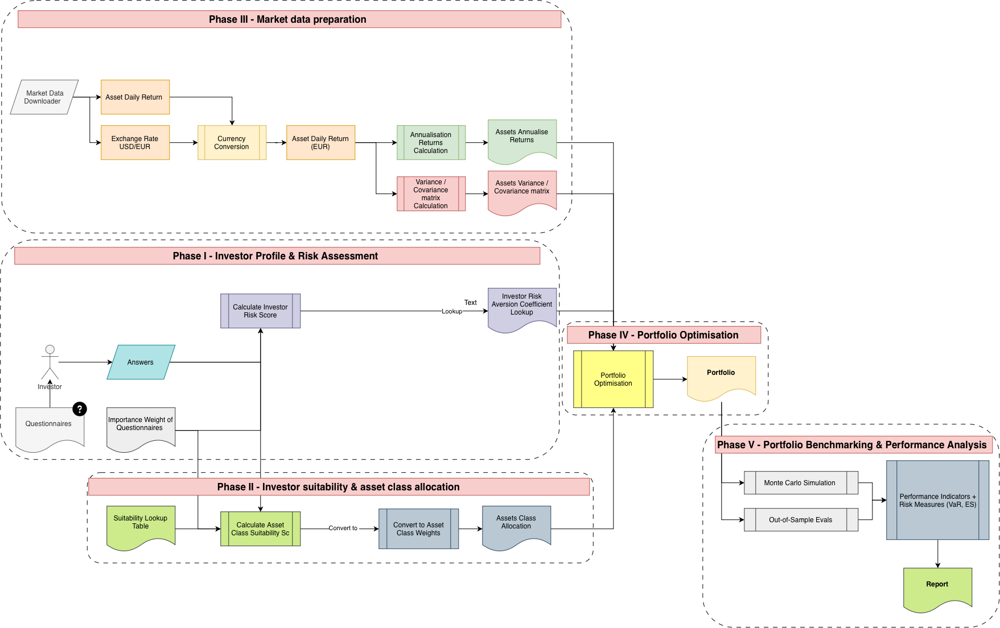

# FIN42350 Capital Markets - Group Project - [(Streamlit Live Application)](https://fin42350-capital-market-group-project.streamlit.app)

A client-specific, multi-asset portfolio construction and risk-analysis framework developed for the FIN42350 Capital Markets group assignment at UCD Michael Smurfit Graduate Business School.

The project translates an investor questionnaire into an asset-class allocation, constructs an optimised exchange-traded fund (ETF) portfolio, and evaluates its performance against the S&P 500 using out-of-sample testing and simulation.

---

## Overview

The framework constructs a portfolio for an investor with an initial capital of EUR 1 million. It combines investor preferences with historical market data to produce a transparent allocation across five asset classes:

- Equity
- Fixed income
- Cash
- Real estate
- Commodities

Daily market data are obtained from Yahoo Finance and converted into euro-denominated returns. A five-year in-sample period is used to estimate expected returns and the variance-covariance matrix, while the final two years are retained for out-of-sample evaluation.

---

## Motivation

Retail portfolio tools often separate investor profiling, asset allocation, portfolio optimisation, and performance analysis. This project connects these decisions within one reproducible workflow, showing how an investor's objectives and constraints affect both the selected assets and the resulting risk-return profile.

Three representative investors are included:

- Risky investor
- Balanced investor
- Conservative investor

The Streamlit application also allows users to enter their own capital and express asset-class preferences through simple qualitative selections.

---

## Project Workflow

The methodology consists of five phases:

1. **Investor Profile and Risk Assessment**  
   Questionnaire responses and importance weights are combined into an investor risk score and risk-aversion coefficient.

2. **Investor Suitability and Asset-Class Allocation**  
   A suitability lookup maps the selected answers to asset-class scores, which are normalised into allocation constraints.

3. **Market Data Preparation**  
   Daily adjusted prices and USD/EUR exchange rates are collected, returns are expressed in euro, and annualised return and covariance estimates are prepared.

4. **Portfolio Optimisation**  
   Mean-variance optimisation determines the ETF weights subject to the investor-specific asset-class constraints.

5. **Portfolio Benchmarking and Performance Analysis**  
   The frozen portfolio is compared with the S&P 500 using out-of-sample growth, return, volatility, Sharpe ratio, maximum drawdown, beta, Jensen's alpha, Value at Risk, Expected Shortfall, and Monte Carlo simulation.



---

## Repository Contents

| Path | Description |
| --- | --- |
| [`portfolio.py`](portfolio.py) | Streamlit demonstration application |
| [`FIN42350 Capital Market - Group Project.ipynb`](FIN42350%20Capital%20Market%20-%20Group%20Project.ipynb) | Reproducible five-phase analysis notebook |
| [`asset_universe.csv`](asset_universe.csv) | Multi-asset ETF universe and metadata |
| [`output/five_phase_workflow/`](output/five_phase_workflow/) | Prepared data and saved analysis results |
| [`report/report.pdf`](report/report.pdf) | Compiled project report |
| [`report/report.tex`](report/report.tex) | LaTeX source for the report |
| [`FIN42350 Group Project.pdf`](FIN42350%20Group%20Project.pdf) | Original assignment specification |

---

## Running the Project

Create and activate a virtual environment, then install the project dependencies:

```bash
python3 -m venv .venv
source .venv/bin/activate
python -m pip install -r requirements.txt
```

Run the Streamlit application:

```bash
streamlit run portfolio.py
```

To reproduce the complete analysis, open the project notebook after installing the dependencies:

```bash
jupyter notebook "FIN42350 Capital Market - Group Project.ipynb"
```

---

## Outputs

The notebook and application provide:

- Investor risk scores and risk-aversion classifications
- Investor-specific asset-class allocations
- Optimised ETF holdings and euro allocations
- Out-of-sample wealth growth from an initial EUR 1 million
- Portfolio and S&P 500 performance comparisons
- Historical Value at Risk and Expected Shortfall estimates
- One-year Monte Carlo wealth scenarios

---

## Author

**Mina Youssef**  
Student Number: 14200381  
UCD Michael Smurfit Graduate Business School

